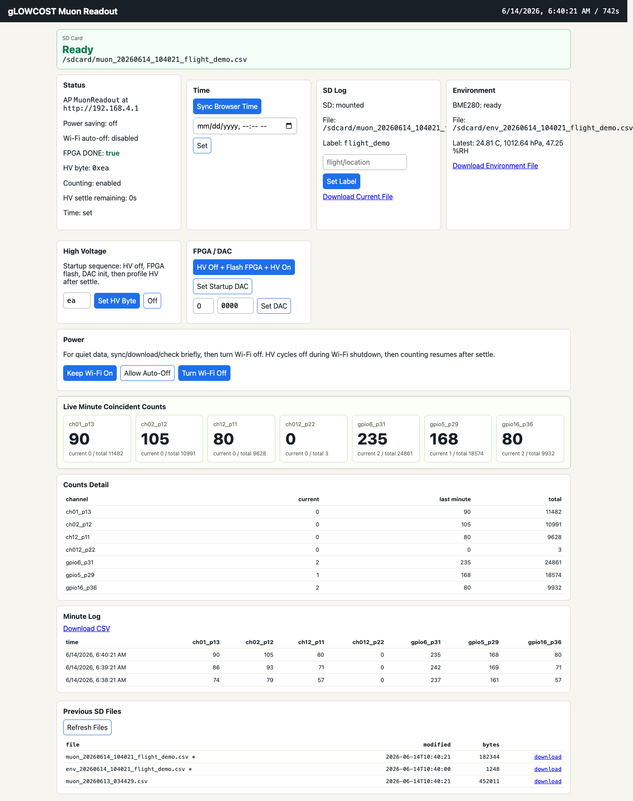

# ESP32-P4 gLOWCOST CubeSat Muon Readout

ESP-IDF firmware for running a gLOWCOST/MPPC cosmic-muon detector readout on a Waveshare ESP32-P4 Module DEV KIT. It adapts the Raspberry Pi HAT readout workflow to the ESP32-P4 40-pin header, including FPGA programming, high-voltage control, DAC threshold setup, one-minute count logging, BME280 environment logging, a Wi-Fi setup page, and an optional ESP32-S3-GEEK BLE live display.

## Introduction

This project is part of the gLOWCOST detector development effort connected to the [Georgia State University global cosmic-ray muon detector network](https://cosmic.gsu.edu/). The GSU project uses low-cost scintillator and SiPM-based muon detectors to build a distributed network for monitoring cosmic-ray count changes related to space weather and atmospheric conditions.

This repository contains the ESP32-P4 embedded readout used for portable field and flight measurements. The firmware starts the detector from a USB power bank, programs the FPGA, sets the high-voltage and DAC operating points, records timestamped count data to a microSD card, and provides a short Wi-Fi setup window for checking status and downloading files. After setup, Wi-Fi can be turned off so the detector can continue a quieter, lower-power flight run.

## Quick Start: Using The Detector

This is the normal field-use procedure for an already-built detector.

### 1. Power Up

1. Insert a FAT32-formatted microSD card before power-up.
2. Power the ESP32-P4 from a USB power bank.
3. Leave the detector still for startup.
4. Wait for the firmware to flash the FPGA, set the DAC/HV values, and finish the 10-second HV settle delay.
5. A new muon data file and environment file are created on the SD card for each detector start.

At boot the firmware turns HV off first, programs the FPGA, sets the DACs, turns HV on, waits 10 seconds, then starts recording. This avoids logging startup noise as detector data.

Add field-use photos here when ready:

- `docs/assets/power-bank-run.jpg`
- `docs/assets/detector-in-use.jpg`
- `docs/assets/sd-card-ready.jpg`

### 2. Open The Web Page

After power-up, connect your phone or computer to:

| Field | Value |
| --- | --- |
| Wi-Fi SSID | `MuonReadout` |
| Wi-Fi password | `glowcost` |
| Web page | `http://192.168.4.1` |

The browser automatically syncs time to the detector. The first browser sync in each boot renames the active SD files using the browser's local clock time.

### 3. Check The Run

1. Confirm the web page shows **SD Card Ready**.
2. Confirm FPGA status is good and HV is on.
3. Check the highlighted live one-minute coincidence counts.
4. Add a run label if useful, such as location, flight number, or test name.
5. Download a quick file only if needed.

### 4. Run Quietly On Battery

Wi-Fi can add noise, so use it only for setup and quick checks.

1. After the SD card, time, label, and counts look good, press **Turn Wi-Fi Off** or let Wi-Fi auto-off.
2. The firmware briefly turns HV off during Wi-Fi shutdown, then turns HV back on and waits for the normal settle delay.
3. The detector keeps counting and logging to the SD card while Wi-Fi is off.
4. Leave the power bank connected for the full run.

To access the web page again after Wi-Fi has been turned off, power-cycle the detector. A new run file will be created on the next start.

### 5. Download Data

For web downloads, connect to `MuonReadout` while Wi-Fi is active and use:

- **Download Current File** for the active muon count file
- **Download Environment File** for the active BME280 file
- **Previous SD Files** for older `.csv` and `.log` files, newest first

For a USB serial quick check from a Mac:

```sh
python3 -m serial.tools.miniterm /dev/cu.usbmodem1101 115200
```

Useful serial commands:

```text
status
counts
sd status
sd tail current 20
sd list
```

## Updating Firmware

Normal detector use does not require reflashing. Use this only when installing a new firmware version.

```sh
idf.py set-target esp32p4
idf.py build
idf.py -p /dev/cu.usbmodem1101 flash
```

If your Mac gives the board a different serial port, check with:

```sh
ls /dev/cu.usbmodem*
```

## Important Safety Behavior

This detector controls high voltage. The firmware turns HV off before startup transitions, FPGA flashing, and Wi-Fi shutdown/restart operations. Counting is disabled while HV is off or settling.

Do not connect or disconnect scintillator/SiPM hardware while HV is enabled. Power down or turn HV off first.

## Current Operating Settings

| Setting | Current value |
| --- | --- |
| FPGA bitstream | `top_50MHz_led100_dt200_pi10us.bin` embedded as `main/fpga.bin` |
| HV byte | `0xea` |
| HV settle delay | 10 seconds |
| DACx578 address | `0x47` |
| SiPM DAC channels 0-3 | `0x2f1` |
| Threshold DAC channels 4-7 | `0x080` |
| Count interval | 60 seconds |
| Environment interval | 5-minute averages |
| Wi-Fi SSID | `MuonReadout` |
| Wi-Fi password | `glowcost` |
| Wi-Fi auto-off | 7 seconds if no client is connected |
| BLE display name | `MuonP4` |

## Web Interface

The web page highlights SD-card readiness, live one-minute coincident counts, HV/FPGA/DAC controls, environment readings, current log downloads, and previous SD files.



Add phone/laptop web UI photos here when ready:

- `docs/assets/web-ui-phone.jpg`
- `docs/assets/live-counts-display.jpg`

The active profile is adapted from `tharinduudu/mppcInterface-Oct-2025` for the new layout 3v0 readout. The current Pi reference snapshot checked during ESP32 sync was commit `9c9868d`.

## Current Hardware Profile

- Controller: Waveshare ESP32-P4 Module DEV KIT, tested on ESP32-P4 rev v1.3.
- Readout board: gLOWCOST/MPPC Raspberry Pi HAT-style detector interface.
- FPGA: iCE40 programmed from embedded `main/fpga.bin`.
- Active FPGA bitstream: `top_50MHz_led100_dt200_pi10us.bin` from the Oct-2025 readout repository.
- High voltage: MAX1932 controlled over SPI, startup byte `0xea`.
- DAC: DACx578 on I2C address `0x47`.
- Startup DAC values: channels 0-3 at `0x2f1`; threshold channels 4-7 at `0x080`.
- Bias target: restored to the earlier bench-tested voltage profile while threshold tuning continues.
- Environment sensor: optional BME280 on I2C `0x76` or `0x77`.
- Storage: onboard microSD card in SPI mode.
- Optional quick-look display: Waveshare ESP32-S3-GEEK running `display/s3-geek-ble-display`.

## What The Firmware Does

At boot, the ESP32-P4:

1. Turns HV off.
2. Programs the iCE40 FPGA from `main/fpga.bin`.
3. Starts the FPGA runtime clock.
4. Initializes the DACx578 startup values.
5. Enables HV to `0xea`.
6. Waits 10 seconds before counting, so startup noise is not logged.
7. Mounts the SD card and creates a fresh data file.
8. Starts a Wi-Fi access point and web UI for setup, status, downloads, and controls.
9. Starts BLE live-count advertisements for the S3 screen display.
10. Automatically turns Wi-Fi off after the setup window when no client is connected, while SD logging, counting, and BLE live display continue.

## Optional S3-GEEK Display

Flash the optional ESP32-S3-GEEK BLE display:

```sh
cd display/s3-geek-ble-display
idf.py set-target esp32s3
idf.py build
idf.py -p /dev/cu.usbmodem11301 flash monitor
```

## Guides

- [Detector Operation Guide](docs/operation-guide.md)
- [Detector Sections Explained](docs/detector-sections.md)
- [Build, Flash, And Development Guide](docs/developer-guide.md)
- [Data Files And SD Logging](docs/data-format.md)
- [Threshold Tuning Results](docs/threshold-tuning-results.md)
- [Troubleshooting](docs/troubleshooting.md)

## Repository Layout

```text
CMakeLists.txt
sdkconfig
sdkconfig.defaults
dependencies.lock
main/
  CMakeLists.txt
  idf_component.yml
  app_common.h
  app_state.c
  console.c
  counters.c
  environment.c
  hardware.c
  main.c
  storage.c
  web.c
  fpga.bin
display/
  s3-geek-ble-display/
    CMakeLists.txt
    sdkconfig.defaults
    main/
      CMakeLists.txt
      main.c
docs/
  data-format.md
  detector-sections.md
  developer-guide.md
  kicadSCHEMATIC.pdf
  operation-guide.md
  threshold-tuning-results.md
  troubleshooting.md
```

Generated folders such as `build/` and `managed_components/` are intentionally ignored.

## Current Status

The latest cleaned firmware removes temporary debug diagnostics used during tuning. It keeps SD logging, BME280 environment logging, temperature compensation, web setup, FPGA flashing, HV protection, power-saving behavior, and the BLE live display path.
